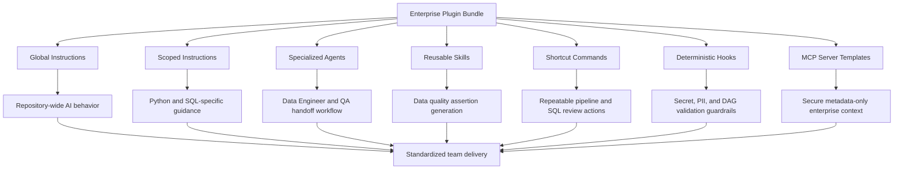

# Enterprise AI Data Engineering Plugin Bundle: Architecture and Design

## Purpose

This plugin bundle standardizes AI-assisted data-engineering practices across enterprise teams. It packages repository instructions, specialized agents, reusable skills, shortcut commands, deterministic validation hooks, and secure MCP server templates into one distributable toolkit.

The bundle is designed for teams building PySpark pipelines, Medallion Lakehouse transformations, Airflow DAGs, warehouse SQL, and governed data products.

## Design Goals

1. **Consistency across teams:** Apply the same engineering, security, data quality, and observability standards across repositories.
2. **Safe AI-assisted generation:** Prevent generated code from introducing hardcoded credentials, unsafe data access, unbounded distributed operations, or invalid DAG definitions.
3. **Composable guidance:** Keep global rules, language-specific instructions, agents, skills, commands, hooks, and MCP definitions modular.
4. **Enterprise-ready distribution:** Allow central platform teams to version, publish, and roll out the toolkit to multiple data teams.
5. **Preview-compatible implementation:** Keep implementation conceptual where tooling is still evolving, while preserving a concrete folder structure that can be adopted by current Copilot-compatible repository configuration.

## Bundle Contents

| Capability | Path | Purpose |
| --- | --- | --- |
| Global repository standards | `.github/copilot-instructions.md` | Baseline engineering, security, compliance, observability, and validation expectations. |
| Agent workflow guidance | `AGENTS.md` | Repository operating model for inspection, implementation, validation, and handoff. |
| Data engineer agent | `.github/agents/data-engineer.agent.md` | Specialized PySpark, Medallion, ETL, and Airflow implementation agent. |
| QA engineer agent | `.github/agents/qa-engineer.agent.md` | Specialized validation agent for data quality, null audits, uniqueness checks, and `chispa` tests. |
| Python instructions | `.github/instructions/python.instructions.md` | Scoped PySpark, Python, logging, typing, docstring, and Airflow rules. |
| SQL instructions | `.github/instructions/sql.instructions.md` | Scoped warehouse SQL style, performance, partition, join, and audit rules. |
| Data quality skill | `.github/skills/data-quality-checker/SKILL.md` | On-demand data quality assertion guidance. |
| PySpark DQ skill | `.github/skills/pyspark-data-quality/` | PySpark validation skill, rule template, and vectorized check script. |
| Pipeline review command | `.github/commands/review-pipeline.md` | Shortcut command for distributed pipeline architecture review. |
| SQL optimization command | `.github/commands/optimize-sql.md` | Shortcut command for CTE rewrites and partition-bound SQL optimization. |
| Secret and PII guard hook | `.github/hooks/pre-commit-guard.js` | Deterministic scanner for generated or staged content. |
| Airflow DAG validator hook | `.github/hooks/post-gen-validator.py` | Deterministic syntax and `airflow dags test` validator. |
| BigQuery MCP template | `.github/mcp-servers/enterprise-bigquery.json` | Metadata-only BigQuery schema, partition, and cost-estimation connector template. |
| Catalog MCP template | `.github/mcp-servers/internal-catalog.json` | Metadata-only lineage and table contract connector template. |
| Plugin manifest | `.github/plugin-manifest.yml` | Conceptual bundle manifest for registry, scaffold CLI, IDE extension, or future Copilot plugin packaging. |
| Node package manifest | `package.json`, `bin/data-eng-toolkit-setup.js` | Optional internal npm, CLI, or VSIX packaging metadata, setup wrapper, and validation scripts. |
| Initialization script | `setup-toolkit.sh` | Installs toolkit assets into target repositories, creates local MCP config, and registers Git hooks. |

## Packaging and Distribution Mechanism

The enterprise distribution model assumes the bundle is version-controlled in a dedicated core repository:

```text
https://github.com/enterprise/data-eng-copilot-bundle
```

Target repositories consume the bundle through one of these supported channels:

| Channel | Mechanism | Notes |
| --- | --- | --- |
| Git submodule | `git submodule add https://github.com/enterprise/data-eng-copilot-bundle tools/data-eng-copilot-bundle` | Best for teams that want pinned versions and transparent source. |
| Scaffold CLI | Internal CLI downloads a release archive and runs `setup-toolkit.sh`. | Best for bootstrapping many repositories consistently. |
| Internal IDE extension | A `.vsix` package contributes commands, manifest metadata, and setup actions. | Best when the enterprise wants one-click developer setup. |
| Copilot/plugin manifest | `.github/plugin-manifest.yml` describes instructions, agents, skills, commands, hooks, and MCP servers. | Conceptual until plugin packaging support is generally available. |

The implemented bundle includes:

- `.github/plugin-manifest.yml` as the portable manifest.
- `package.json` and `bin/data-eng-toolkit-setup.js` as the optional Node package, CLI, or VS Code extension packaging layer.
- `setup-toolkit.sh` as the initialization script.
- `.github/mcp-servers/*.json` as secure MCP endpoint templates.
- `.github/hooks/*` as deterministic validation hooks.

## Conceptual Plugin Manifest

The repository includes `.github/plugin-manifest.yml`. If preview plugin tooling supports a top-level manifest in the future, the bundle can be represented as:

```yaml
name: enterprise-data-engineering-ai-toolkit
version: 1.0.0
description: Standard AI-assisted data-engineering toolkit for PySpark, SQL, Airflow, data quality, and governed metadata access.
publisher: enterprise-data-platform-team

instructions:
  global:
    - .github/copilot-instructions.md
    - AGENTS.md
  scoped:
    - path: .github/instructions/python.instructions.md
      applyTo: "**/*.py"
    - path: .github/instructions/sql.instructions.md
      applyTo: "**/*.sql"

agents:
  - .github/agents/data-engineer.agent.md
  - .github/agents/qa-engineer.agent.md

skills:
  - .github/skills/data-quality-checker/SKILL.md
  - .github/skills/pyspark-data-quality/SKILL.md

commands:
  - name: review-pipeline
    path: .github/commands/review-pipeline.md
  - name: optimize-sql
    path: .github/commands/optimize-sql.md

hooks:
  pre_generation_or_commit:
    - .github/hooks/pre-commit-guard.js
  post_generation:
    - .github/hooks/post-gen-validator.py

mcpServers:
  - .github/mcp-servers/enterprise-bigquery.json
  - .github/mcp-servers/internal-catalog.json
```

This manifest is conceptual for preview tooling, but it is stored as a real file so a future registry, scaffold CLI, IDE extension, or Copilot plugin packager can consume it.

## Runtime Architecture



## Execution Flow

1. A developer requests a pipeline, SQL, data quality, or DAG task.
2. Global repository standards and `AGENTS.md` define safe baseline behavior.
3. File-specific instructions load for Python or SQL work.
4. The Data Engineer agent can implement PySpark or Medallion pipeline changes.
5. The QA Engineer agent can validate pipeline quality, null handling, uniqueness, and tests.
6. Skills provide task-specific data quality patterns and reusable PySpark validation logic.
7. Commands standardize recurring review and optimization workflows.
8. Hooks run deterministic checks for secrets, PII, and generated DAG validity.
9. MCP server templates provide governed metadata access without exposing credentials or raw row data.

## Distribution Model

The enterprise platform team can distribute the bundle using these models:

| Model | Description | Best For |
| --- | --- | --- |
| Repository template | Create new data projects from a standard template containing this bundle. | New teams and greenfield projects. |
| Internal package artifact | Publish the bundle as a versioned archive and copy files during project bootstrap. | Existing repositories and controlled rollout. |
| Central sync workflow | Use an internal automation workflow to sync `.github`, `AGENTS.md`, and docs into approved repositories. | Large-scale enterprise standardization. |
| Git submodule | Pin `github.com/enterprise/data-eng-copilot-bundle` under a target repository path such as `tools/data-eng-copilot-bundle`. | Teams that need transparent updates and version pinning. |
| Scaffold CLI | Run an internal command such as `data-eng-toolkit init --version v1.2.0`. | Automated onboarding and self-service setup. |
| IDE extension or plugin package | Distribute as a `.vsix` or future Copilot plugin manifest package. | Central developer-experience rollout. |
| Internal npm package | Publish `@enterprise/data-eng-copilot-bundle` to a private registry. | Teams that already standardize developer tooling through npm. |

### Git Submodule Consumption

```sh
git submodule add https://github.com/enterprise/data-eng-copilot-bundle tools/data-eng-copilot-bundle
git commit -m "Add data engineering AI toolkit bundle"
tools/data-eng-copilot-bundle/setup-toolkit.sh --target . --mode symlink
```

To pin a specific version:

```sh
cd tools/data-eng-copilot-bundle
git fetch --tags
git checkout v1.2.0
cd ../..
git add tools/data-eng-copilot-bundle
git commit -m "Pin data engineering AI toolkit to v1.2.0"
```

### Scaffold CLI Consumption

An internal CLI can wrap the same script:

```sh
data-eng-toolkit init --version v1.2.0 --target . --mode copy
```

The CLI should:

1. Resolve the requested semantic version.
2. Download or clone the matching bundle release.
3. Execute `setup-toolkit.sh`.
4. Report installed files, skipped existing files, MCP config status, and hook registration status.

The included `package.json` exposes the setup script as an npm binary through `bin/data-eng-toolkit-setup.js`, which locates `sh`, `bash`, or Git Bash before delegating to `setup-toolkit.sh`:

```sh
npx @enterprise/data-eng-copilot-bundle --target . --mode copy
```

If the package is installed locally, teams can also run:

```sh
npm run validate
```

The package is marked `private` by default to prevent accidental public publishing. Internal release automation can remove or override that setting when publishing to the approved enterprise registry.

### IDE Extension or Plugin Consumption

An internal `.vsix` or plugin package can use `.github/plugin-manifest.yml` as metadata and expose setup commands such as:

- `Data Engineering Toolkit: Install`
- `Data Engineering Toolkit: Update`
- `Data Engineering Toolkit: Validate Hooks`
- `Data Engineering Toolkit: Configure MCP`

For a VS Code extension, `package.json` can be expanded with extension-specific fields such as `publisher`, `engines.vscode`, `activationEvents`, and `contributes`. The current manifest intentionally stays lightweight so it can serve npm and CLI distribution without forcing VSIX packaging immediately.

## Installation Sequence

1. Add the bundle through a submodule, scaffold CLI, downloaded artifact, or internal IDE extension.
2. Run `setup-toolkit.sh --target <repo> --mode copy` or `setup-toolkit.sh --target <repo> --mode symlink`.
3. Review `.vscode/mcp.json` and configure approved MCP bridge commands through environment variables.
4. Confirm `.git/hooks/pre-commit` was installed.
5. Confirm Python, Node.js, Airflow, PySpark, and `chispa` availability where applicable.
6. Run a smoke validation of the hooks and documentation links.

## Initialization Script Behavior

`setup-toolkit.sh` performs three setup actions:

1. **Installs toolkit assets:** Copies or symlinks `.github/instructions`, `.github/agents`, `.github/skills`, `.github/commands`, `.github/hooks`, `.github/mcp-servers`, `.github/copilot-instructions.md`, `.github/plugin-manifest.yml`, and `AGENTS.md`.
2. **Registers MCP endpoints:** Creates `.vscode/mcp.json` with `enterprise-bigquery` and `internal-catalog` server entries that use environment variables instead of committed secrets.
3. **Installs active Git hooks:** Writes `.git/hooks/pre-commit` so staged files are scanned by `pre-commit-guard.js`; staged DAG files under `dag/` or `dags/` are also validated by `post-gen-validator.py` with Airflow validation skipped when the CLI is unavailable.

The script does not overwrite existing files unless `--force` is passed.

## Security Model

The bundle follows secure-by-default principles:

- No credentials, tokens, service account keys, or connection strings are stored in files.
- MCP server templates use environment variables, managed identity, workload identity, or application default credentials.
- BigQuery and catalog MCP templates are metadata-only by default.
- Hooks block likely secrets, private keys, credential-bearing connection strings, and high-risk PII.
- Logging guidance prohibits sensitive values in logs.

## Governance Model

The enterprise data platform team should own:

- Bundle versioning.
- Approved MCP server binaries or container images.
- Security scanning pattern updates.
- Agent and skill updates.
- SQL and PySpark standards.
- Rollout notes and migration guidance.

Application teams should own:

- Repository-specific pipeline code.
- Runtime environment variables.
- DAG schedule and dependency configuration.
- Dataset-specific data quality rules.
- Project-level test coverage.

## Versioning Strategy

Use semantic versioning:

- **Major:** Breaking agent behavior, hook requirements, MCP protocol changes, or repository layout changes.
- **Minor:** New commands, skills, validation rules, or optional MCP capabilities.
- **Patch:** Documentation updates, typo fixes, safer pattern updates, or non-breaking guidance improvements.

### Version Lifecycle Management

Teams should pin toolkit versions for stable delivery:

| Lifecycle Stage | Example | Purpose |
| --- | --- | --- |
| Initial adoption | `v1.0.0` | Baseline bundle rollout. |
| Feature upgrade | `v1.2.0` | Adds new skills, commands, or optional MCP capabilities. |
| Patch update | `v1.2.1` | Fixes hook rules, documentation, or non-breaking validation behavior. |
| Breaking upgrade | `v2.0.0` | Changes layout, hook behavior, MCP contracts, or agent workflows. |

For submodules, the consuming repository pins a Git commit or tag. For scaffold CLI and IDE extension distribution, the consuming team should record the installed version in release notes or a generated metadata file.

## Adoption Checklist

- [ ] Global instructions copied to `.github/copilot-instructions.md`.
- [ ] `AGENTS.md` copied to the repository root.
- [ ] Python and SQL scoped instruction files installed.
- [ ] Data Engineer and QA Engineer agents installed.
- [ ] Data quality skills installed.
- [ ] Shortcut commands installed.
- [ ] Hooks registered locally or in CI.
- [ ] `.github/plugin-manifest.yml` installed.
- [ ] `package.json` reviewed if npm, CLI, or VSIX distribution is planned.
- [ ] `setup-toolkit.sh` executed or equivalent scaffold automation completed.
- [ ] MCP server templates configured with environment variables.
- [ ] README updated to explain repository-specific usage.
- [ ] A sample pipeline or SQL task has been validated with the toolkit.

## Future Enhancements

- Add a formal plugin manifest when the target AI tooling supports bundle packaging.
- Add CI examples for running `pre-commit-guard.js` and `post-gen-validator.py`.
- Add team-specific extension points for Snowflake, Databricks Unity Catalog, dbt, or Great Expectations.
- Add policy-as-code integration for enterprise data classification and retention checks.
- Add signed bundle releases for supply-chain verification.
