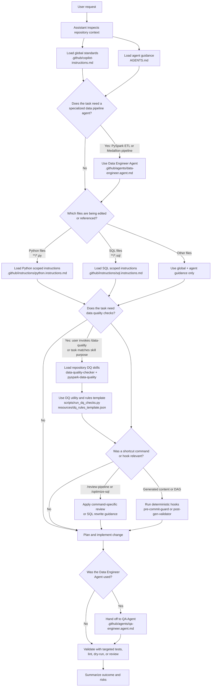
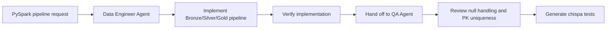
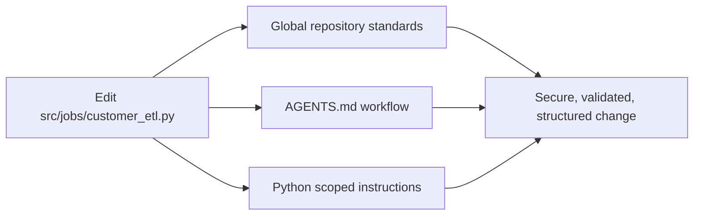
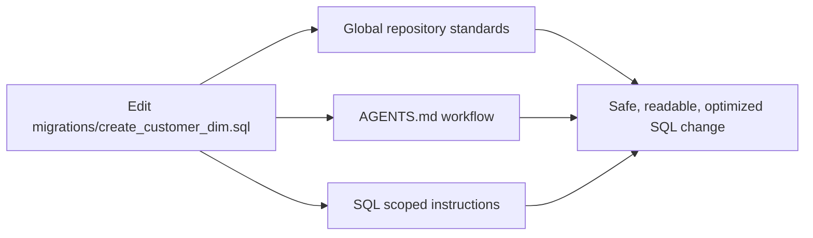
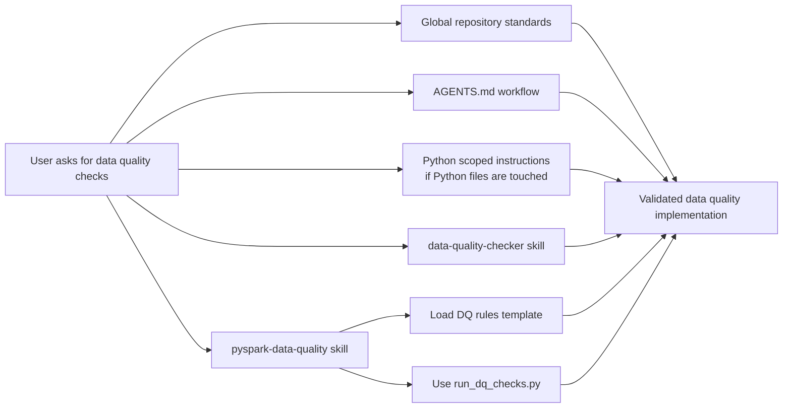
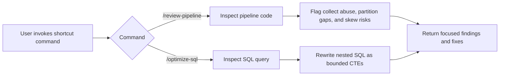

# Conceptual Architecture of Scoped Instructions

As codebases grow, applying a single blanket instruction set across Python pipelines, SQL migrations, and configuration YAML files can lead to prompt dilution and conflicting style enforcement. This repository uses hierarchical and glob-scoped instructions so each assistant receives only the guidance relevant to the current task.

## Implemented Instruction Layers

| Layer | File | Scope | Purpose |
| --- | --- | --- | --- |
| Plugin Bundle Architecture | `PLUGIN_ARCHITECTURE_DESIGN.md` | Enterprise distribution | Describes the conceptual plugin bundle, runtime architecture, distribution model, governance, and adoption checklist. |
| GenAI Directory Guide | `GENAI_DIRECTORY.md` | Repository documentation | Documents the directory layout, ownership model, extension guidelines, and quick validation commands. |
| Plugin Manifest | `.github/plugin-manifest.yml` | Packaging metadata | Declares bundle version, distribution modes, instructions, agents, skills, commands, hooks, MCP servers, and setup actions. |
| Node Package Manifest | `package.json`, `bin/data-eng-toolkit-setup.js` | Optional npm, CLI, or VSIX packaging | Provides package metadata, internal package name, cross-platform setup command wrapper, packaged files, and validation scripts. |
| Toolkit Setup Script | `setup-toolkit.sh` | Target repository initialization | Copies or symlinks toolkit assets, creates local MCP config, and installs Git hooks. |
| Global Repository Instructions | `.github/copilot-instructions.md` | Entire repository | Universal engineering, security, compliance, observability, and validation standards. |
| Agent Context | `AGENTS.md` | Repository and workspace behavior | Agent operating principles, workspace boundaries, and task execution sequence. |
| Custom Data Engineer Agent | `.github/agents/data-engineer.agent.md` | Specialized agent invocation | Builds production PySpark ETL pipelines and Medallion Lakehouse transformations, then hands off validation to QA. |
| Quality Assurance Agent | `.github/agents/qa-engineer.agent.md` | Handoff from Data Engineer agent | Reviews PySpark pipeline quality, validates data assertions, and generates `chispa` unit tests. |
| Scoped Python Instructions | `.github/instructions/python.instructions.md` | `**/*.py` | Python, PySpark, data quality, typing, docstring, logging, and Airflow standards. |
| Scoped SQL Instructions | `.github/instructions/sql.instructions.md` | `**/*.sql` | SQL formatting, data warehouse performance, joins, audit columns, and migration standards. |
| Repository Skill | `.github/skills/data-quality-checker/SKILL.md` | On-demand skill invocation | Specialized data quality assertion checks, null audits, and schema validation guidance. |
| PySpark Data Quality Skill | `.github/skills/pyspark-data-quality/SKILL.md` | On-demand PySpark DQ invocation | Executes PySpark DataFrame quality checks using `scripts/run_dq_checks.py` and baseline rules from `resources/dq_rules_template.json`. |
| Shortcut Commands | `.github/commands/review-pipeline.md`, `.github/commands/optimize-sql.md` | On-demand command invocation | Provides repeatable review and SQL optimization prompts for pipeline architecture and warehouse query tuning. |
| Deterministic Hooks | `.github/hooks/pre-commit-guard.js`, `.github/hooks/post-gen-validator.py` | Generated code and DAG validation | Scans generated content for secrets or PII and validates generated Airflow DAGs with artifact-free Python syntax checks and `airflow dags test`. |
| MCP Server Templates | `.github/mcp-servers/enterprise-bigquery.json`, `.github/mcp-servers/internal-catalog.json` | Runtime MCP configuration | Defines secure metadata-only connectors for BigQuery schemas, partition metadata, cost estimates, and catalog lineage. |

## How the Flow Works

For enterprise rollout details, use `PLUGIN_ARCHITECTURE_DESIGN.md`. For a file-by-file map of this repository, use `GENAI_DIRECTORY.md`.

For multi-team distribution, publish this directory as the core bundle repository, for example `github.com/enterprise/data-eng-copilot-bundle`, and consume it from target repositories through a Git submodule, scaffold CLI, internal `.vsix` package, or future Copilot plugin manifest. `setup-toolkit.sh` performs the local initialization by installing toolkit files, writing `.vscode/mcp.json`, and registering `.git/hooks/pre-commit`.

`package.json` is included for optional internal npm, CLI, or VS Code extension packaging. It keeps the package private by default, exposes `data-eng-toolkit-setup` through a Node wrapper around `setup-toolkit.sh`, and provides validation scripts for hook syntax, CLI wrapper syntax, and package metadata.

When an AI coding assistant works in this repository, it builds its working context from multiple instruction layers. The layers are additive, but each layer has a different responsibility so the assistant receives broad repository rules first and file-specific rules only when they are relevant.



### End-to-End Execution Sequence

1. **User asks for a change.** The request may mention a feature, bug, pipeline, migration, DAG, documentation update, or configuration change.
2. **Global instructions are always active.** `.github/copilot-instructions.md` supplies repository-wide rules such as security, secret handling, structured logging, focused changes, and validation expectations.
3. **Agent guidance shapes the working behavior.** `AGENTS.md` tells the assistant to inspect before modifying, preserve workspace boundaries, make incremental changes, and validate with the narrowest useful command.
4. **A specialized agent may be selected.** For PySpark ETL, Medallion Lakehouse, or production pipeline implementation tasks, `.github/agents/data-engineer.agent.md` supplies the role, tools, model, and completion criteria for the Data Engineer agent.
5. **The assistant identifies relevant files.** If the work touches Python files, SQL files, or both, the matching scoped instruction files are loaded into context.
6. **Skills are loaded only when needed.** If the user invokes `/data-quality` or the task explicitly requires data quality checks, null audits, schema validations, or PySpark data cleansing, repository skills provide specialized implementation guidance. `.github/skills/data-quality-checker/SKILL.md` provides general data quality patterns, while `.github/skills/pyspark-data-quality/SKILL.md` provides PySpark-specific rule selection, utility execution, and failure reporting guidance.
7. **Scoped rules refine implementation.** Python work receives PySpark, type hint, docstring, logging, and Airflow rules. SQL work receives keyword casing, `snake_case`, CTE, join, partition-filter, and audit-column rules.
8. **The assistant implements using the combined context.** Global rules define the baseline, `AGENTS.md` defines the workflow, custom agents define specialized roles, scoped files define language-specific standards, and skills add task-specific depth only when relevant.
9. **Shortcut commands standardize repeatable reviews.** `/review-pipeline` checks for `.collect()` abuse, missing partition pruning, and join skew risk. `/optimize-sql` rewrites nested SQL into CTE-based queries with explicit partition bounds.
10. **Hooks enforce deterministic guardrails.** `.github/hooks/pre-commit-guard.js` scans generated or staged content for AWS/GCP keys, connection strings, generic tokens, and high-risk PII. `.github/hooks/post-gen-validator.py` validates generated Airflow DAG files with Python compilation and `airflow dags test`.
11. **MCP server templates expose metadata safely.** `.github/mcp-servers/enterprise-bigquery.json` and `.github/mcp-servers/internal-catalog.json` define environment-driven, metadata-only integrations for schemas, partitions, cost estimates, and lineage without committing raw credentials.
12. **Pipeline work is handed off for QA.** When the Data Engineer agent completes pipeline implementation, it hands off to `.github/agents/qa-engineer.agent.md` to verify null handling, primary key uniqueness, and `chispa` test coverage.
13. **The assistant validates and reports.** Validation should match the change type, such as `pytest` for Python transformations, SQL dry-runs for migrations, data quality assertions for validation tasks, hook execution for generated artifacts, or documentation review for README-only changes.

## How the Files Are Connected

### Global Repository Instructions

`.github/copilot-instructions.md` applies across the full repository and contains baseline standards that should never conflict with language-specific rules:

- Do not hardcode credentials, tokens, private keys, or connection strings.
- Use clear names and self-documenting implementation patterns.
- Keep changes focused, reviewable, and covered by relevant tests or validation.
- Use structured logging without exposing sensitive values.
- Route Python and SQL-specific standards to scoped instruction files.

This file is the top-level policy layer. It should stay concise and avoid detailed Python or SQL rules so those details do not pollute unrelated tasks.

### Agent Guidance

`AGENTS.md` defines how coding agents should operate in this repository:

1. Inspect existing schemas, configurations, source files, and tests before modifying code.
2. Make the smallest coherent change set.
3. Validate incrementally with targeted tests, linting, dry-runs, or review commands.
4. Preserve workspace boundaries and avoid unrelated rewrites.
5. Summarize changed files, validation, and any remaining risk.

This file is the process layer. It does not replace global or scoped rules; it explains how the assistant should execute work safely and consistently.

### Custom Agents

`.github/agents/data-engineer.agent.md` defines a specialized Data Engineer agent for production PySpark ETL and Medallion Lakehouse implementation. It owns pipeline design and implementation directives such as Bronze/Silver/Gold structure, explicit `StructType` schemas, distributed-safe PySpark usage, and audit timestamp requirements.

`.github/agents/qa-engineer.agent.md` defines the QA handoff target. It reviews implemented pipeline code, verifies null handling and primary key uniqueness, and generates or updates `chispa` unit tests.

Example flow for Data Engineer to QA handoff:



### Glob-Scoped Python Instructions

`.github/instructions/python.instructions.md` is loaded only for Python files matching `**/*.py`. It contains PySpark, data quality, type safety, documentation, structured logging, and Airflow orchestration standards.

Example flow for Python work:



### Glob-Scoped SQL Instructions

`.github/instructions/sql.instructions.md` is loaded only for SQL files matching `**/*.sql`. It contains SQL keyword casing, `snake_case` naming, CTE formatting, explicit join requirements, partition-filter guidance, and audit-column expectations.

Example flow for SQL work:



### Repository Skills

`.github/skills/data-quality-checker/SKILL.md` and `.github/skills/pyspark-data-quality/SKILL.md` are not blanket instruction files. They are on-demand skills used when the task specifically involves data quality checks or when the user invokes `/data-quality`.

The general `data-quality-checker` skill adds focused guidance for:

- Schema integrity checks.
- Primary key null audits.
- Numeric range checks.
- Timestamp consistency validation.
- PySpark validation helper generation.

The `pyspark-data-quality` skill adds a runnable PySpark validation structure:

- `SKILL.md` defines when the skill is used and how to report failed assertions.
- `scripts/run_dq_checks.py` provides `execute_dq_suite()` for primary key uniqueness and required-column null checks.
- `resources/dq_rules_template.json` defines baseline assertion standards for primary keys, timestamps, and numeric metrics.

Example flow for data quality work:



### Shortcut Commands

`.github/commands/review-pipeline.md` defines `/review-pipeline`, a focused review command for PySpark and data pipeline architecture. It checks for:

- Unsafe `.collect()` or `.toPandas()` usage on unbounded distributed DataFrames.
- Missing partition pruning filters on partitioned reads.
- Join skew risks and missing mitigation strategies.
- Audit and lineage preservation, including `created_at` and `updated_at`.

`.github/commands/optimize-sql.md` defines `/optimize-sql`, a SQL rewrite command that converts deeply nested subqueries into readable CTEs while preserving semantics. It also enforces uppercase SQL keywords, explicit joins, required partition bounds, and audit-column preservation for mutable outputs.

Example flow for shortcut command work:



### Deterministic Hooks

`.github/hooks/pre-commit-guard.js` provides a dependency-free Node.js scanner that accepts file paths or stdin. It blocks content containing likely cloud keys, private key markers, database URLs with embedded credentials, generic token assignments, and high-risk PII patterns.

`.github/hooks/post-gen-validator.py` validates generated Airflow DAG files before handoff. It:

- Validates DAG Python syntax without writing bytecode artifacts.
- Infers DAG IDs from common `DAG(...)` constructor patterns or accepts explicit `--dag-id` values.
- Runs `airflow dags test <dag_id> <execution_date>` with the generated DAG folder as the Airflow DAG folder.
- Emits structured JSON logs for pass, skip, and failure events.

Example hook usage:

```powershell
node .github\hooks\pre-commit-guard.js path\to\generated_file.py
python .github\hooks\post-gen-validator.py dags\generated_dag.py --dag-id generated_pipeline --execution-date 2024-01-01
```

### MCP Server Templates

`.github/mcp-servers/enterprise-bigquery.json` defines the secure metadata access contract for corporate BigQuery environments. It is designed for schema inspection, partition metadata, and cost estimates, not raw row extraction.

`.github/mcp-servers/internal-catalog.json` defines the secure metadata access contract for internal lineage catalogs such as DataHub or OpenMetadata. It supports dataset ownership, upstream lineage, downstream lineage, and table contracts.

Both MCP templates intentionally use environment variables and managed identity patterns instead of committed credentials:

- `ENTERPRISE_BIGQUERY_MCP_COMMAND`
- `BIGQUERY_PROJECT_ID`
- `BIGQUERY_LOCATION`
- `INTERNAL_CATALOG_MCP_COMMAND`
- `INTERNAL_CATALOG_URL`
- `INTERNAL_CATALOG_TOKEN` when a managed identity is not available

## Conflict Avoidance

The instruction files are intentionally separated by responsibility:

| Question | Source of Truth |
| --- | --- |
| Should secrets be hardcoded? | `.github/copilot-instructions.md` |
| Should the assistant inspect before editing? | `AGENTS.md` |
| Who implements production PySpark ETL pipelines? | `.github/agents/data-engineer.agent.md` |
| Who validates pipeline quality after implementation? | `.github/agents/qa-engineer.agent.md` |
| Should PySpark reads use explicit schemas? | `.github/instructions/python.instructions.md` |
| Should SQL keywords be uppercase? | `.github/instructions/sql.instructions.md` |
| How should data quality assertions be generated? | `.github/skills/data-quality-checker/SKILL.md` |
| How should PySpark DQ checks be executed and reported? | `.github/skills/pyspark-data-quality/SKILL.md`, `.github/skills/pyspark-data-quality/scripts/run_dq_checks.py`, and `.github/skills/pyspark-data-quality/resources/dq_rules_template.json` |
| How should pipeline architecture be reviewed quickly? | `.github/commands/review-pipeline.md` |
| How should nested SQL be optimized? | `.github/commands/optimize-sql.md` |
| How should generated content be scanned for secrets and PII? | `.github/hooks/pre-commit-guard.js` |
| How should generated Airflow DAG syntax be validated? | `.github/hooks/post-gen-validator.py` |
| How should BigQuery and catalog metadata be exposed to assistants? | `.github/mcp-servers/enterprise-bigquery.json` and `.github/mcp-servers/internal-catalog.json` |
| Should changes be validated before handoff? | `.github/copilot-instructions.md` and `AGENTS.md` |

## Benefits

- Reduces prompt dilution by keeping global instructions concise.
- Prevents Python, SQL, and configuration guidance from conflicting.
- Keeps repository-wide safety and quality standards consistently applied.
- Makes assistant behavior easier to review because each instruction file has a clear scope.
